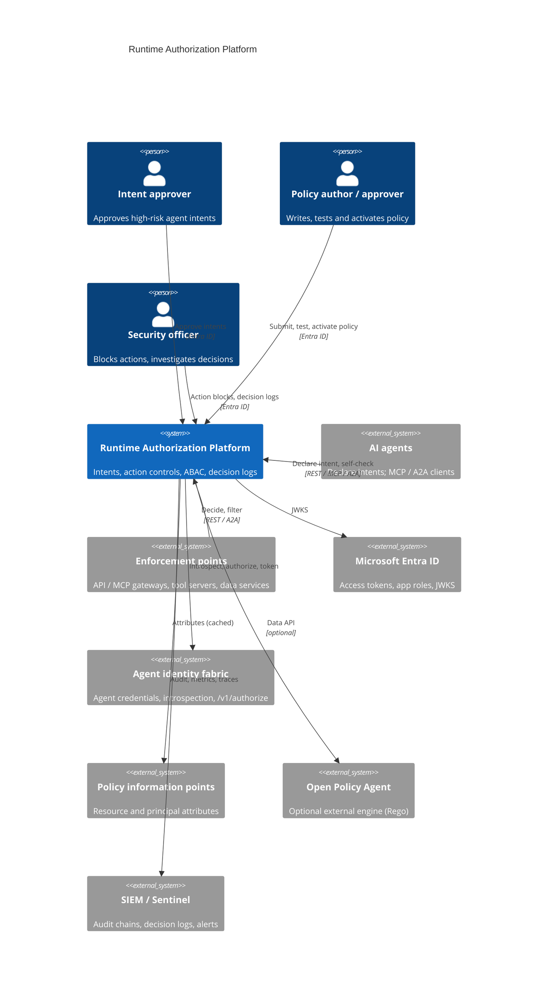
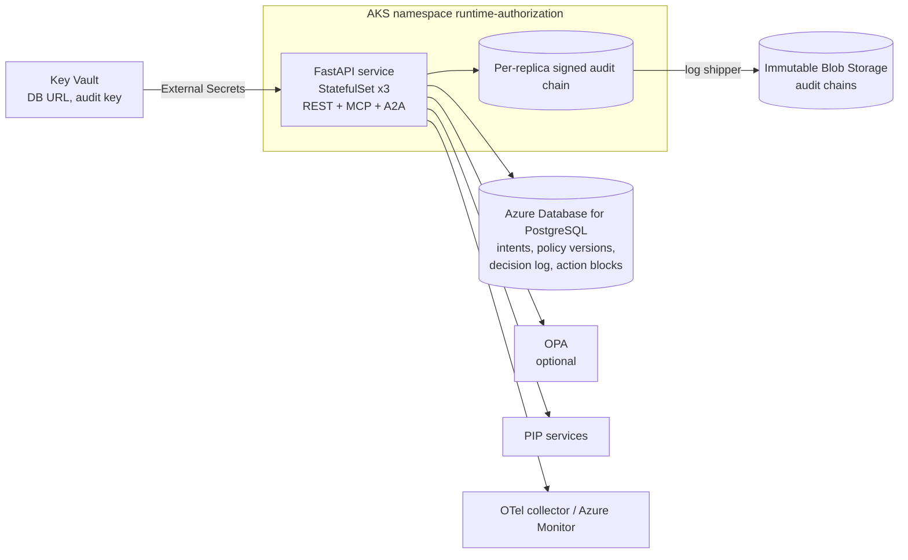
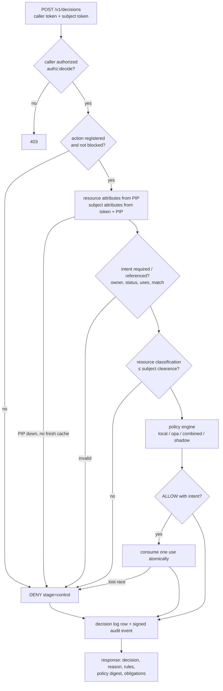
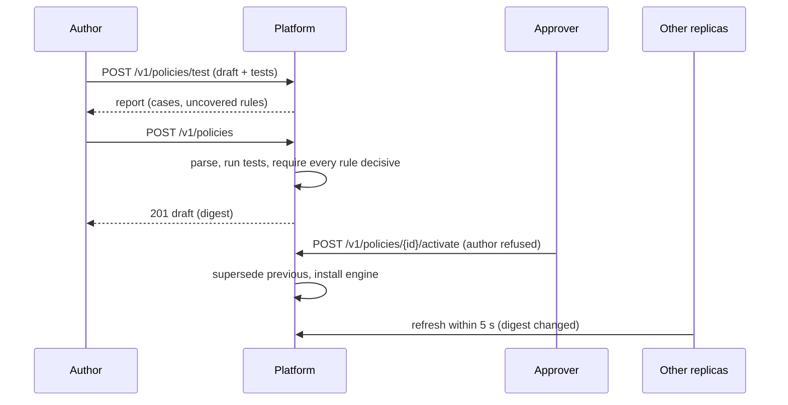
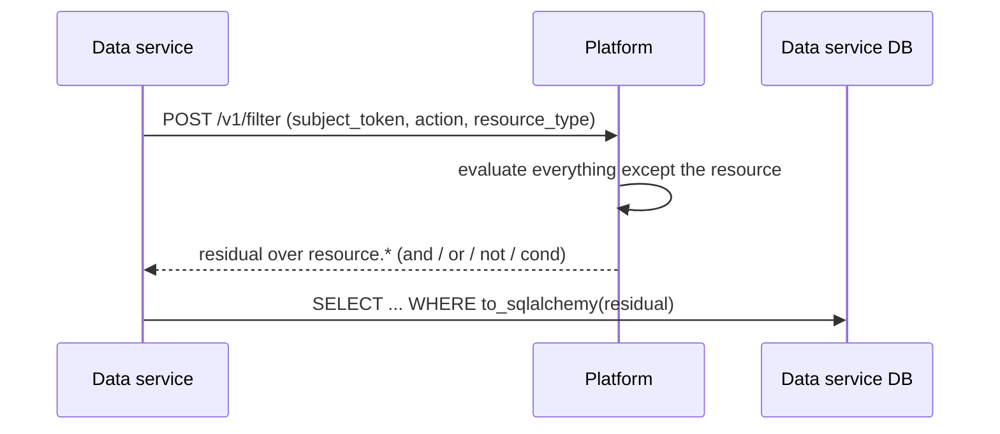
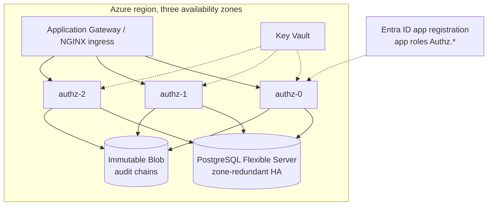

# Architecture

## Business problem

Agents call tools: they send email, change records, move money, scale
clusters. Identity tells us *which* agent is calling; it does not tell us
whether *this* call, on *this* resource, *right now*, for *this* stated
reason, should go ahead. Static scopes granted at registration are either too
broad (an agent with `documents:*` can delete anything) or too brittle (every
new resource needs a new grant). Security and audit teams also need to show,
after the fact, which policy version allowed an action, what the agent said it
was doing, and who approved it.

The Runtime Authorization Platform is the policy decision point (PDP) for
agent actions. Enforcement points (API and MCP gateways, tool servers, data
services) ask it before every action; agents declare intent before high-risk
actions; humans approve what policy says needs approval; every decision is
logged with the policy digest that produced it.

Flow: **Intent → Policy → Resource → Authorization → Decision**.

## System context (C4 level 1)



## Containers (C4 level 2)



## Components (C4 level 3)

| Layer | Module | Responsibility |
|---|---|---|
| API | `api.routes`, `api.app` | REST contract, OAuth-style errors, correlation IDs, metrics |
| API | `api.mcp` | MCP server (official SDK, streamable HTTP, stateless JSON) with four tools |
| API | `api.a2a` | Agent Card and JSON-RPC `message/send` routing to skills |
| Application | `application.decisions` | Decision pipeline and partial-evaluation filtering |
| Application | `application.intents` | Intent declaration, screening, approval (four-eyes), consumption |
| Application | `application.policies` | Policy submission with tests, activation, rollback, replica convergence |
| Application | `application.controls` | Action catalog and emergency action blocks |
| Policy | `policy.engines` | Local agentic-core engine, OPA, combined, shadow |
| Policy | `policy.partial`, `policy.rego`, `policy.testing` | Partial evaluation, Rego export, policy unit tests |
| Integrations | `integrations.pip`, `opa`, `fabric` | Attribute sources with cache, OPA client, identity-fabric client |
| Security | `security.entra`, `authn`, `access`, `roles` | Entra ID validation, token routing, service access policy |
| Infrastructure | `infrastructure.database`, `sql_filter` | SQLAlchemy Core repositories; residual push-down to SQL |
| Runtime | `runtime.container` | Composition root |

Shared controls come from [agentic-core](https://github.com/kogunlowo123/agentic-core):
`PolicyEngine`/`PolicySet` (ABAC), `AuditLog` (signed hash chain),
`PromptInjectionDetector`, `SecretScanner`, `PiiDetector`, logging and
telemetry.

## Decision pipeline



## Sequences

### Intent with human approval

```mermaid
sequenceDiagram
  participant A as Agent
  participant G as Gateway (PEP)
  participant P as Platform
  participant H as Approver
  A->>P: POST /v1/intents (action, resource, justification, purpose)
  P->>P: catalog check, secret scan, injection screening, PII redaction
  P-->>A: 201 intent (active, max_uses)
  A->>G: call tool (agent token, intent id)
  G->>P: POST /v1/decisions (subject_token, intent_id)
  P-->>G: require_approval, obligations [approve_intent]
  H->>P: POST /v1/intents/{id}/approve (not the declarer)
  A->>G: retry
  G->>P: POST /v1/decisions
  P->>P: policy allows; consume 1 use
  P-->>G: allow (policy digest, intent uses 1/1)
  G->>G: execute tool call
```

### Policy change



### List filtering (partial evaluation)



Partial evaluation and full evaluation share the same condition code;
property-based tests check they agree on every generated policy and resource
(`tests/unit/test_partial.py`), and SQL push-down is checked row for row
against full decisions (`tests/unit/test_sql_filter.py`).

## MCP integration

Mounted at `/mcp` with the official `mcp` SDK (`MCPServer`, streamable HTTP,
stateless, JSON responses). Tools, all with typed input and output schemas:

| Tool | Operation checked | Effect |
|---|---|---|
| `declare_intent` | `authz:intent:declare` | Declares an intent as the caller |
| `check_authorization` | `authz:decide:self` | Dry-run decision as the caller |
| `filter_resources` | `authz:filter` | Residual and allowed candidates |
| `get_intent` | owner only | Intent status |

A bearer token is required before the SDK parses the request (401 otherwise);
each tool re-authenticates from the request headers, checks the operation,
and writes an audit event. DNS-rebinding protection accepts only the public
host. MCP decisions are dry runs: only enforcement points consume intents.

## A2A communication

`GET /.well-known/agent-card.json` publishes name, description, url
(`/a2a`), version, capabilities (no streaming or push), three skills
(`decide`, `declare_intent`, `filter`) and security schemes (Entra ID client
credentials; agent identity fabric bearer when configured). `POST /a2a`
implements JSON-RPC 2.0 `message/send`: the first `data` part carries
`{"skill", "input"}`; the reply is an A2A `Message` with a `data` part holding
the result. Errors use JSON-RPC codes (-32700, -32600, -32601, -32602) and
-32000 with `data.error` for authorization failures.

## Observability

Prometheus metrics (own registry) for HTTP latency, decisions by outcome and
stage, decision latency, intent events, PIP cache outcomes, OPA shadow
comparisons, active policy, MCP/A2A calls; JSON logs with correlation IDs and
secret scrubbing; OpenTelemetry traces (FastAPI instrumentation, OTLP).
Alert rules in `configs/prometheus/alerts.yaml`; dashboard in
`configs/grafana/runtime-authorization-platform.json`.

## CI/CD

`ci.yml`: ruff, black, mypy --strict, bandit, contract drift, policy unit
tests, pytest with a 90% coverage gate on Python 3.12 and 3.13; PostgreSQL
and OPA integration (Rego parity); Helm lint/render/kubeconform and
required-value failure check; Terraform fmt/validate for AWS, Azure and GCP;
Trivy config and image scans; Syft SBOM and Grype gate; Semgrep; a container
smoke test. `release.yml` on `v*.*.*`: the same gates, image to GHCR with
provenance attestation, Helm chart to GHCR OCI, Rego bundle, SBOM, GitHub
release.

## Deployment (Azure reference)



Terraform (`deployments/terraform/azure`) creates the Entra app registration
with the seven app roles and v2 access tokens, the PostgreSQL server (TLS
required, private network only), Key Vault (RBAC, purge protection, no public
access), immutable storage for audit chains, and a user-assigned identity
federated to the platform's service account (Azure Workload Identity). AWS
(RDS, Secrets Manager, S3 Object Lock, IRSA) and GCP (Cloud SQL, Secret
Manager, retention-locked bucket, Workload Identity) are equivalent.

## Cost and scalability

Decisions are CPU-bound and stateless apart from PostgreSQL writes (one
decision-log row and one audit line per decision). Three replicas of 1 vCPU
handle the measured budget of under 50 ms per decision including the log
write (`tests/performance`); the HPA scales on CPU to 15 replicas. The PIP
cache keeps attribute lookups off the hot path (sub-100 µs cache hits).
Partial evaluation turns list filtering from N decisions into one call plus a
SQL predicate. Decision-log rows are purged after the retention period (400
days by default) because the signed audit chain is the long-term record in
immutable storage. The main cost drivers are the zone-redundant PostgreSQL
server and log storage; both scale with decision volume, not agent count.

## Acceptance criteria

| # | Criterion | Evidence |
|---|---|---|
| 1 | Unregistered or blocked actions are denied before policy | `test_t10_unregistered_and_blocked_actions`, `test_action_block_kill_switch` |
| 2 | Required intents are enforced, single-use, owner-bound, approvable only by someone else | `test_intent_approval_flow`, `test_t6_*`, `test_t8_*` |
| 3 | Entra ID tokens are fully validated (tenant, issuer, audience, time, alg) | `tests/unit/test_entra.py`, `test_t1_*` |
| 4 | Resource attributes come from PIPs with caching and fail closed | `tests/unit/test_pip.py`, `tests/chaos/test_dependency_failures.py` |
| 5 | Policies ship only with passing tests that exercise every rule | `test_policy_authoring_four_eyes_and_rollback`, CI policy step |
| 6 | Every decision is in the decision log and the signed audit chain | `test_intent_approval_flow`, `test_audit_failure_blocks_decisions` |
| 7 | Filtering agrees with deciding | `test_residual_matches_full_evaluation`, `test_pushdown_matches_policy` |
| 8 | Rego export decides exactly like the local engine | `tests/integration/test_opa_parity.py` (real OPA in CI) |
| 9 | MCP and A2A surfaces are authenticated, authorized and audited | `test_mcp_tools`, `test_a2a_message_send`, `test_a2a_errors` |
